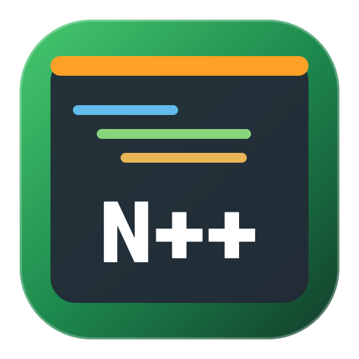
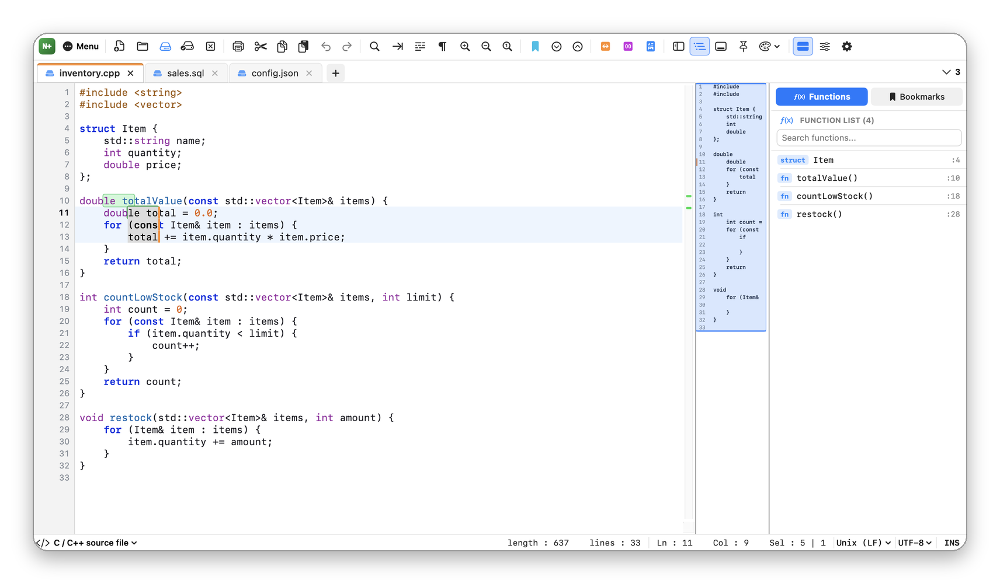
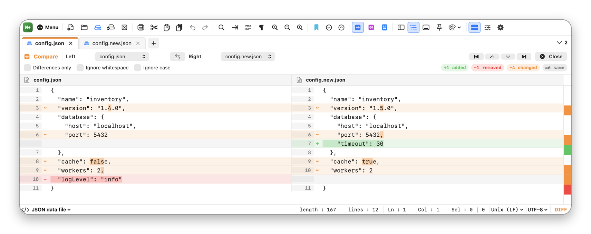
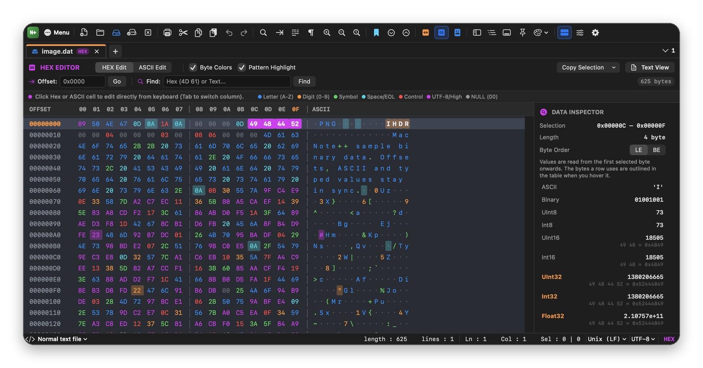
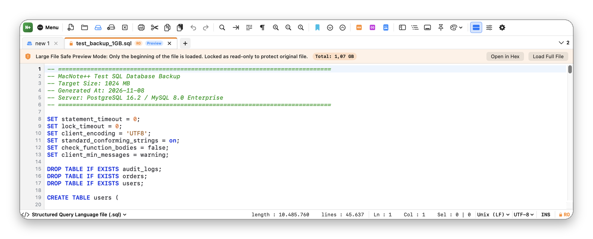

<p align="center">
  
</p>

<h1 align="center">MacNote++</h1>

<p align="center">
  A free, open-source <b>text, code and hex editor</b> for macOS: tabs, syntax highlighting, multiple cursors, file compare and large-file support.<br>
  Written in Swift (AppKit and SwiftUI); no Electron.
</p>

<p align="center">
  A free alternative to <b>BBEdit</b>, <b>CotEditor</b> and <b>Sublime Text</b> for everyday text and code editing on the Mac.
</p>

<p align="center">
  <b>🇬🇧 English</b> · <a href="README.tr.md">🇹🇷 Türkçe</a>
</p>

<p align="center">
  <a href="https://gitlab.com/freeware2/macnotepp/-/releases/permalink/latest/downloads/MacNotePP.zip"></a>
</p>

<p align="center">
  <a href="https://gitlab.com/freeware2/macnotepp/-/releases">All releases</a> · <a href="#download-and-install">Installation steps</a> · <a href="#faq">FAQ</a>
</p>

> [!warning] The first time you open MacNote++, macOS blocks it. This is expected.
> MacNote++ is free and not notarized by Apple, so the first time you open it macOS says it *could not verify* the app. You only need to allow it once:
>
> 1. In the warning, click **Done**. Do **not** click *Move to Trash*.
> 2. Open **System Settings ▸ Privacy & Security** and scroll down to **Security**.
> 3. On the line saying MacNote++ was blocked, click **Open Anyway** and confirm with your password or Touch ID.
>
> Prefer Terminal? Run `xattr -dr com.apple.quarantine "/Applications/MacNote++.app"`, then open MacNote++.

## Screenshots

### Tabs, multiple cursors and function list

Syntax highlighting for 21 languages, a minimap and a function list. Every cursor has its own selection, so typing, deleting, Shift + arrows and paste work on all of them at once.

<p align="center"></p>

### Compare two tabs

Side-by-side differences with changes marked inside the line, an overview bar and buttons to jump between differences.

<p align="center"></p>

### Hex editor and data inspector

Select bytes with the mouse or keyboard. The inspector shows each value together with the bytes it uses and their order, and outlines those bytes in the table.

<p align="center"></p>

### Large files

Very large files open in a safe, read-only preview. Load the whole file when you need it, or browse all of it in hex.

<p align="center"></p>

<p align="center"><sub>Screenshots from the English interface, with sample files. You can switch to Turkish in Settings without restarting.</sub></p>

## Features

**Editing**
- Tabs you can reorder by dragging, pin and lock as read-only
- Syntax highlighting for 21 languages, detected from the file name and content
- Multiple cursors (⌥ + click, ⌥⇧↑ / ↓) and rectangular selection (⌥ + drag)
- Column editor (⌥C): insert text or number sequences in decimal, hex, octal or binary
- Line tools: sort, remove duplicates or empty lines, trim, join, tabs ↔ spaces, move and duplicate lines
- Upper, lower, title, sentence and inverted case
- Macro recording and playback
- Undo and redo for each tab

**Find**
- Find, replace and mark with normal, extended (`\n`, `\t`) and regular expression modes
- Search the current document, all open documents or a whole folder, with clickable results
- Bookmarks: navigate, copy, cut or delete bookmarked lines
- Function list for C / C++, Pascal, SQL and more

**Compare and hex**
- Side-by-side compare, with options to ignore whitespace or case
- Hex editor with direct byte editing and multi-byte selection
- Data inspector: integers up to 64 bits, floats, little or big endian
- Copy selections as hex, C array or Pascal array

**Files**
- Encodings: UTF-8, UTF-8 with BOM, UTF-16 LE / BE, Windows-1254, ISO-8859-9, Windows-1252, ASCII
- Line endings: LF, CRLF and CR, kept when you save
- Open tabs come back when you reopen the app
- Reloads files changed by other apps, and asks before overwriting them if you have unsaved changes
- Warns before saving characters the file's encoding cannot hold
- Print preview with PDF output

**Tools and appearance**
- Markdown live preview
- JSON and SQL formatting, Base64 and URL encoding, MD5 and SHA-256
- Four editor themes, English and Turkish interface, customizable toolbar
- Mac (⌘), Windows (Ctrl) or combined keyboard shortcuts
- Self-update from GitLab with SHA-256, app id and signature checks

## Download and install

1. **[Download MacNotePP.zip](https://gitlab.com/freeware2/macnotepp/-/releases/permalink/latest/downloads/MacNotePP.zip)** (macOS 14 or later, Apple Silicon and Intel).
2. Unzip it and move `MacNote++.app` to **Applications**.
3. Allow it once, as described at the top of this page.

### Verifying the download

Download [`MacNotePP.zip.sha256`](https://gitlab.com/freeware2/macnotepp/-/releases/permalink/latest/downloads/MacNotePP.zip.sha256) to the same folder and run:

```bash
shasum -a 256 -c MacNotePP.zip.sha256
```

## Building from source

Requires macOS 14 and the Swift toolchain (Xcode or Command Line Tools).

```bash
git clone https://gitlab.com/freeware2/macnotepp.git
cd macnotepp
./build_app.sh
open "MacNote++.app"
```

## Known limits

- Files of 80 MB or more ask how to open: preview, hex view or the whole file. Tested up to 1 GB.
- Files of 20 MB or more open locked as read-only. You can unlock them for editing, but typing may be slower.
- Loading a whole very large file pauses the window for a few seconds at the end.
- In hex view, files over 20 MB can be browsed and searched but not edited.

## FAQ

### Is MacNote++ free?

Yes. It is free and open source under the GPL-3.0-or-later license, with no ads, accounts or in-app purchases.

### Does it send my files anywhere?

No. The only network request is the update check, which reads the latest release information from gitlab.com at most once a day. You can turn it off in Settings.

### Can it open very large files?

Yes. Files of 80 MB or more can open as a preview, and hex view reads even a 1 GB file from disk as you scroll.

### Can I edit several lines at once?

Yes. Add cursors with ⌥ + click or ⌥⇧↑ / ↓, or select a rectangle with ⌥ + drag, then type.

### Which Macs does it run on?

macOS 14 or later, on Apple Silicon and Intel.

### Why does macOS block it the first time?

MacNote++ is not notarized by Apple, so macOS asks you to allow it once. Updates installed from inside the app do not ask again.

## License

GPL-3.0-or-later. See [LICENSE](LICENSE). Developed by Rafet SAPANCI. MacNote++ is an independent project and is not affiliated with Apple.
