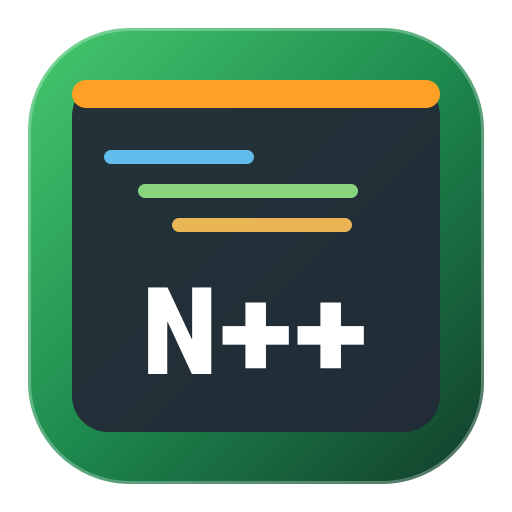
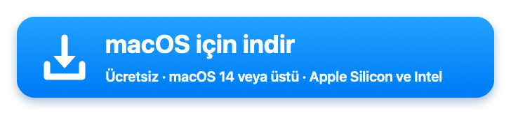
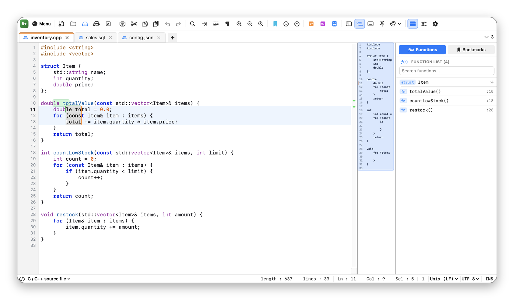
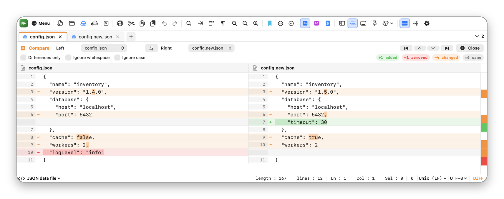
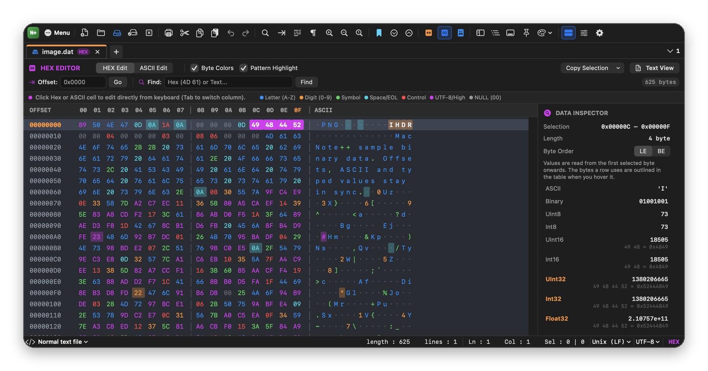
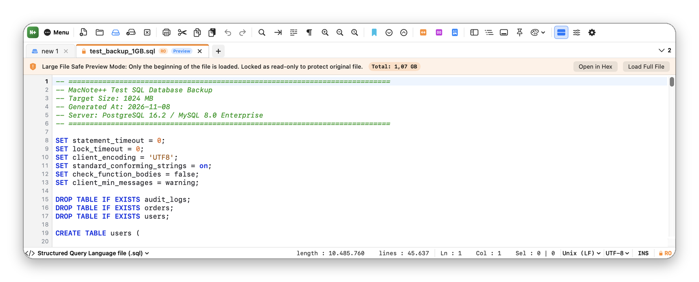

<p align="center">
  
</p>

<h1 align="center">MacNote++</h1>

<p align="center">
  macOS için ücretsiz, açık kaynak <b>metin, kod ve hex düzenleyici</b>: sekmeler, sözdizimi renklendirme, çoklu imleç, dosya karşılaştırma ve büyük dosya desteği.<br>
  Swift ile yazıldı (AppKit ve SwiftUI); Electron yok.
</p>

<p align="center">
  Mac'te günlük metin ve kod düzenleme için <b>BBEdit</b>, <b>CotEditor</b> ve <b>Sublime Text</b>'e ücretsiz bir alternatif.
</p>

<p align="center">
  <a href="README.md">🇬🇧 English</a> · <b>🇹🇷 Türkçe</b>
</p>

<p align="center">
  <a href="https://gitlab.com/freeware2/macnotepp/-/releases/permalink/latest/downloads/MacNotePP.zip"></a>
</p>

<p align="center">
  <a href="https://gitlab.com/freeware2/macnotepp/-/releases">Tüm sürümler</a> · <a href="#indirme-ve-kurulum">Kurulum adımları</a> · <a href="#sık-sorulan-sorular">Sık sorulan sorular</a>
</p>

> [!warning] MacNote++'ı ilk açtığınızda macOS engeller. Bu beklenen bir durumdur.
> MacNote++ ücretsizdir ve Apple tarafından onaylanmamıştır (notarized değil), bu yüzden ilk açılışta macOS uygulamayı *doğrulayamadığını* söyler. Yalnızca bir kez izin vermeniz yeterli:
>
> 1. Uyarıda **Bitti**'ye tıklayın. *Çöp Sepeti'ne Taşı*'ya **tıklamayın**.
> 2. **Sistem Ayarları ▸ Gizlilik ve Güvenlik** bölümünü açıp **Güvenlik** başlığına inin.
> 3. MacNote++'ın engellendiğini söyleyen satırda **Yine de Aç**'a tıklayın, parolanız ya da Touch ID ile onaylayın.
>
> Terminal'i mi tercih edersiniz? `xattr -dr com.apple.quarantine "/Applications/MacNote++.app"` komutunu çalıştırıp MacNote++'ı açın.

## Ekran görüntüleri

### Sekmeler, çoklu imleç ve fonksiyon listesi

21 dil için sözdizimi renklendirme, kod haritası ve fonksiyon listesi. Her imlecin kendi seçimi vardır; yazma, silme, Shift + oklar ve yapıştırma hepsinde aynı anda çalışır.

<p align="center"></p>

### İki sekmeyi karşılaştırma

Satır içindeki değişiklikler işaretlenmiş yan yana farklar, genel bakış çubuğu ve farklar arasında gezinme düğmeleri.

<p align="center"></p>

### Hex düzenleyici ve veri denetçisi

Baytları fareyle ya da klavyeyle seçin. Denetçi her değeri kullandığı baytlar ve sıralarıyla birlikte gösterir, o baytları tabloda çerçeveler.

<p align="center"></p>

### Büyük dosyalar

Çok büyük dosyalar güvenli, salt okunur önizlemeyle açılır. Gerektiğinde dosyanın tamamını yükleyebilir ya da tamamını hex görünümünde gezebilirsiniz.

<p align="center"></p>

<p align="center"><sub>Görüntüler İngilizce arayüzden ve örnek dosyalarla alınmıştır. Türkçeye Ayarlar'dan, yeniden başlatmadan geçebilirsiniz.</sub></p>

## Özellikler

**Düzenleme**
- Sürükleyerek sıralanabilen, sabitlenebilen ve salt okunur kilitlenebilen sekmeler
- Dosya adı ve içeriğinden algılanan 21 dil için sözdizimi renklendirme
- Çoklu imleç (⌥ + tık, ⌥⇧↑ / ↓) ve dikdörtgen seçim (⌥ + sürükleme)
- Sütun düzenleyici (⌥C): metin ya da onluk, onaltılık, sekizlik veya ikilik sayı dizisi ekleme
- Satır araçları: sıralama, tekrar eden ve boş satırları silme, boşluk temizleme, birleştirme, TAB ↔ boşluk, satır taşıma ve çoğaltma
- Büyük, küçük, baş harfleri büyük, cümle düzeni ve ters harf dönüşümü
- Makro kaydetme ve oynatma
- Her sekme için ayrı geri alma ve yineleme

**Arama**
- Normal, genişletilmiş (`\n`, `\t`) ve düzenli ifade kiplerinde bulma, değiştirme ve işaretleme
- Geçerli belgede, tüm açık belgelerde ya da bir klasörün tamamında, tıklanabilir sonuçlarla arama
- Yer imleri: gezinme, yer imli satırları kopyalama, kesme ve silme
- C / C++, Pascal, SQL ve diğer diller için fonksiyon listesi

**Karşılaştırma ve hex**
- Boşlukları ya da büyük/küçük harfi yoksayabilen yan yana karşılaştırma
- Doğrudan bayt düzenleme ve çoklu bayt seçimi olan hex düzenleyici
- Veri denetçisi: 64 bite kadar tam sayılar, ondalıklı sayılar, LE ve BE bayt sırası
- Seçimi hex, C dizisi ya da Pascal dizisi olarak kopyalama

**Dosyalar**
- Kodlamalar: UTF-8, BOM'lu UTF-8, UTF-16 LE / BE, Windows-1254, ISO-8859-9, Windows-1252, ASCII
- LF, CRLF ve CR satır sonları; kaydederken korunur
- Açık sekmeler uygulama yeniden açılınca geri gelir
- Ayarlar'dan, seçtiğiniz dosya türleri için MacNote++'ı varsayılan uygulama yapma; önceki uygulamalara dönülebilir
- Başka uygulamaların değiştirdiği dosyalar yenilenir; kaydedilmemiş değişiklik varsa üzerine yazmadan önce sorulur
- Dosyanın kodlamasında olmayan karakterler kaydedilmeden önce uyarır
- PDF çıktılı baskı önizleme

**Araçlar ve görünüm**
- Markdown canlı önizleme
- JSON ve SQL biçimlendirme, Base64 ve URL kodlama, MD5 ve SHA-256
- Dört editör teması, Türkçe ve İngilizce arayüz, özelleştirilebilir araç çubuğu
- Mac (⌘), Windows (Ctrl) ya da birleşik klavye kısayolları
- SHA-256, uygulama kimliği ve imza denetimiyle GitLab'dan kendini güncelleme

## İndirme ve kurulum

1. **[MacNotePP.zip dosyasını indirin](https://gitlab.com/freeware2/macnotepp/-/releases/permalink/latest/downloads/MacNotePP.zip)** (macOS 14 veya üstü, Apple Silicon ve Intel).
2. Zip'i açıp `MacNote++.app` dosyasını **Uygulamalar** klasörüne taşıyın.
3. Bu sayfanın başında anlatıldığı gibi bir kez izin verin.

### İndirmeyi doğrulama

[`MacNotePP.zip.sha256`](https://gitlab.com/freeware2/macnotepp/-/releases/permalink/latest/downloads/MacNotePP.zip.sha256) dosyasını aynı klasöre indirip şunu çalıştırın:

```bash
shasum -a 256 -c MacNotePP.zip.sha256
```

## Kaynaktan derleme

macOS 14 ve Swift araçları (Xcode ya da Command Line Tools) gerekir.

```bash
git clone https://gitlab.com/freeware2/macnotepp.git
cd macnotepp
./build_app.sh
open "MacNote++.app"
```

## Bilinen sınırlar

- 80 MB ve üstü dosyalarda nasıl açılacağı sorulur: önizleme, hex görünümü ya da dosyanın tamamı. 1 GB'a kadar denenmiştir.
- 20 MB ve üstü dosyalar salt okunur kilitli açılır. Kilidi kaldırıp düzenleyebilirsiniz, ancak yazarken yavaşlama olabilir.
- Çok büyük bir dosyanın tamamı yüklenirken sonunda pencere birkaç saniye bekler.
- Hex görünümünde 20 MB üstü dosyalar gezilebilir ve aranabilir, ancak düzenlenemez.

## Sık sorulan sorular

### MacNote++ ücretsiz mi?

Evet. GPL-3.0-or-later lisansıyla ücretsiz ve açık kaynaktır; reklam, hesap ya da uygulama içi satın alma yoktur.

### Dosyalarımı bir yere gönderiyor mu?

Hayır. Tek ağ isteği güncelleme denetimidir; günde en fazla bir kez gitlab.com'dan son sürüm bilgisini okur. Ayarlar'dan kapatabilirsiniz.

### Çok büyük dosyaları açabilir mi?

Evet. 80 MB ve üstü dosyalar önizlemeyle açılabilir; hex görünümü 1 GB'lık dosyayı bile siz kaydırdıkça diskten okur.

### Birden fazla satırı aynı anda düzenleyebilir miyim?

Evet. ⌥ + tık ya da ⌥⇧↑ / ↓ ile imleç ekleyin veya ⌥ + sürükleme ile dikdörtgen seçim yapıp yazın.

### Hangi Mac'lerde çalışır?

macOS 14 veya üstü, Apple Silicon ve Intel.

### macOS neden ilk seferde engelliyor?

MacNote++ Apple tarafından onaylanmamıştır (notarized değil), bu yüzden macOS bir kez izin vermenizi ister. Uygulama içinden kurulan güncellemeler yeniden sormaz.

## Lisans

GPL-3.0-or-later. Bkz. [LICENSE](LICENSE). Geliştiren: Rafet SAPANCI. MacNote++ bağımsız bir projedir, Apple ile bağlantısı yoktur.
